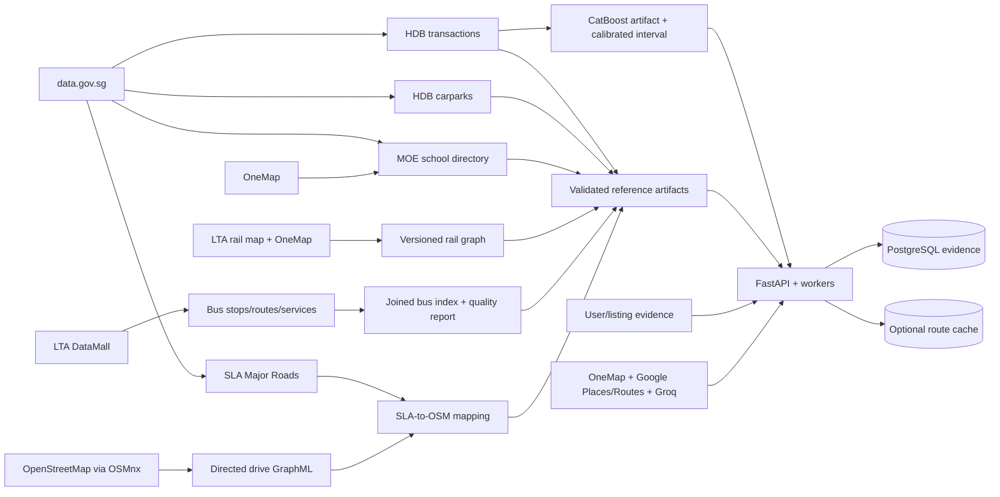

# NearHomeV2 end-to-end data pipeline

## Outcome

NearHomeV2 has one operator entry point for downloading, validating, transforming, joining and
publishing all reference data used by the API:

```bash
apps/api/.venv/bin/python data_pipeline/run_pipeline.py --profile validate
apps/api/.venv/bin/python data_pipeline/run_pipeline.py --profile core
apps/api/.venv/bin/python data_pipeline/run_pipeline.py --profile roads
apps/api/.venv/bin/python data_pipeline/run_pipeline.py --profile all
apps/api/.venv/bin/python data_pipeline/run_pipeline.py --profile realtime
```

`--dry-run` performs credential/dependency preflight and writes a manifest without calling a
provider. `--only STAGE` can be repeated for a focused repair. `--continue-on-error` allows
independent branches to finish while dependent stages remain blocked.

The complete E2E system has two connected data planes:

- The batch/reference plane below produces reviewed, versioned HDB/MOE/LTA/rail/SLA/OSM/model
  artifacts.
- The request-time plane accepts user-confirmed listings, enriches them with live providers and
  those reference artifacts, persists evidence, and returns the deterministic comparison.

## Lineage



## Request-time E2E flow

1. The user creates a session and saves budget, priorities, requirements and important locations.
2. A listing enters through manual confirmation or Smart Paste. URL/text evidence is bounded,
   Groq returns schema-constrained candidates, and the user confirms the final fields.
3. Immediate comparison runs from confirmed listing facts without waiting for an external provider.
4. The API creates a durable enrichment job. Production dispatches it through Google Cloud Tasks
   to the private worker; local development may run inline.
5. The worker OneMap-geocodes each listing, then combines request-time Google route/place evidence
   with the published HDB, MOE, LTA, rail and SLA/OSM artifacts.
6. Deterministic engines calculate comparable-sales/fair-price evidence, school proximity, public
   transport, driving, parking, requirements and preference scores. Provider errors remain explicit
   statuses; no mock value is substituted in live mode.
7. The worker persists observations, journey rows, factor results, provenance, timestamps and model/
   rule versions in PostgreSQL, then marks the durable job complete.
8. The comparison endpoint assembles the latest evidence and deterministic recommendation for the
   web app. Redis, when configured, is only a TTL-bound route-performance cache.

This keeps lineage continuous from source snapshot/request through canonical data, engine version,
persisted evidence and API response.

## Profiles and stage order

### `validate`

1. Validate the LTA bus join and rail graph semantics.
2. Validate every required JSON/CSV/model artifact and enforce production volume floors.

This profile never calls an external provider. It intentionally fails when a tiny demo file is in
a production artifact slot.

### `core`

1. Download the complete official HDB resale CSV through the data.gov.sg initiate/poll-download
   flow.
2. Validate and normalize all HDB rows into the comparable-sales fixture.
3. Refresh HDB static carparks, convert SVY21 coordinates, and upsert the PostgreSQL mirror.
4. Download the MOE school directory, reuse unchanged coordinates, and OneMap-geocode new/changed
   addresses.
5. Bulk-fetch LTA BusStops, BusRoutes and BusServices.
6. Join the LTA snapshots and publish the bus data-quality report.
7. Rebuild versioned rail structure, station and edge artifacts.
8. Apply transport cross-file quality gates.
9. Train and atomically publish the CatBoost artifact from the accepted HDB snapshot.
10. Apply all production artifact/schema/volume gates.

### `roads`

1. Poll/download the large official SLA National Map Line GeoJSON.
2. Filter it to `Layers/Major_Road`.
3. Download and persist Singapore's directed OSM drive graph with OSMnx.
4. Spatially and topologically map SLA Major Roads to OSM edges/entry nodes.
5. Run exhaustive-versus-STRtree diagnostics and evaluate any human gold labels.
6. Apply all production artifact/schema/volume gates.

Google Roads validation remains a separate explicitly authorized QA command because it can make
billable requests. It is never silently included in `all`.

### `all`

Runs the complete `core` and `roads` DAG, then the global gate. Independent branches run in a
stable deterministic order. A consumer cannot run after a selected dependency fails.

### `realtime`

Collects one HDB Carpark Availability snapshot into PostgreSQL. Schedule this profile separately;
it is time-series collection, not a static reference rebuild.

## Atomicity, repeatability and failure behavior

- The generic data.gov.sg downloader stages bytes in the destination directory, fsyncs them and
  atomically replaces the previous raw snapshot only after a complete response is received.
- MOE normalized JSON and metadata use the same atomic publish helper.
- The CatBoost publisher stages both files and atomically replaces the model and metadata.
- Source adapters validate provider payloads; snapshot loaders validate persisted artifacts again.
- Static carpark database import is an idempotent upsert. Static file stages replace a complete
  snapshot; they do not append duplicate rows.
- A failed stage returns non-zero, is captured in the run manifest and blocks selected dependents.
  The last known-good published artifact remains available wherever the stage supports atomic
  publication.
- Provider credentials are inherited from the root `.env` or process environment, with the process
  environment taking precedence. Values are never printed or written to manifests.

## Run manifests

Every invocation writes:

```text
data_pipeline/manifests/<UTC-run-id>.json
data_pipeline/manifests/latest.json
```

Each manifest contains the pipeline/profile version, complete source-ID set, stage order, command,
timestamps, duration, exit status, safe error summary and SHA-256/size for published outputs. Raw
provider bodies and secrets are excluded. The directory is local/generated and ignored by Git;
ship manifests to the deployment's normal restricted observability store if central history is
required.

## Credentials

- `LTA_ACCOUNT_KEY`: LTA bus reference refresh.
- `ONEMAP_EMAIL`, `ONEMAP_PASSWORD`: rail and MOE geocoding.
- `DATA_GOV_SG_API_KEY`: optional for public dataset access, strongly recommended for production
  rate limits.
- `DATABASE_URL`: carpark mirror and carpark-availability collection.
- `GOOGLE_ROADS_API_KEY`: optional manual road-QA only.

Google Routes/Places and Groq are request-time sources and are not called by the static batch
profiles. Their production credentials are still required by API production validation.

## Recommended schedules

- HDB Carpark Availability: every 5–15 minutes with `--profile realtime`.
- Core HDB transactions: monthly, after data.gov.sg publishes the latest month.
- HDB static carparks: daily or after the dataset's `lastUpdatedAt` changes.
- LTA bus snapshots: weekly and after known route/service changes.
- MOE directory: yearly and after the directory changes.
- Rail graph: on every opening, closure, code, interchange or topology change.
- SLA + OSM road artifacts: quarterly and whenever either parent dataset changes.
- CatBoost artifact: after each accepted HDB transaction snapshot.

Use a scheduler that guarantees one active run per profile. Do not run two writers for the same
artifact concurrently.

## Operator checklist

```bash
# 1. See every input before running anything.
apps/api/.venv/bin/python data_pipeline/run_pipeline.py --list-sources

# 2. Preflight a complete refresh.
apps/api/.venv/bin/python data_pipeline/run_pipeline.py --profile all --dry-run

# 3. Run reference branches.
apps/api/.venv/bin/python data_pipeline/run_pipeline.py --profile core
apps/api/.venv/bin/python data_pipeline/run_pipeline.py --profile roads

# 4. Re-run the offline global gate.
apps/api/.venv/bin/python data_pipeline/run_pipeline.py --profile validate

# 5. Inspect exact lineage/hashes.
python -m json.tool data_pipeline/manifests/latest.json
```

The SLA raw file is hundreds of megabytes and the OSM/mapping stages are compute-heavy. Run roads
on a data-build worker with sufficient disk/memory, then promote the reviewed immutable artifacts
with the application image. Runtime enrichment must never download SLA/OSM data per listing.

## Tests

```bash
cd apps/api
pytest -q app/tests/test_data_pipeline.py
```

The tests cover source-catalog completeness/uniqueness, data.gov.sg polling, ZIP dataset selection,
MOE coordinate-cache behavior and DAG dependency order. Existing provider-schema, transport,
road-mapping, model-artifact and API tests cover the downstream contracts.
