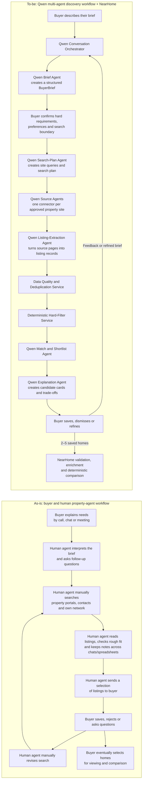
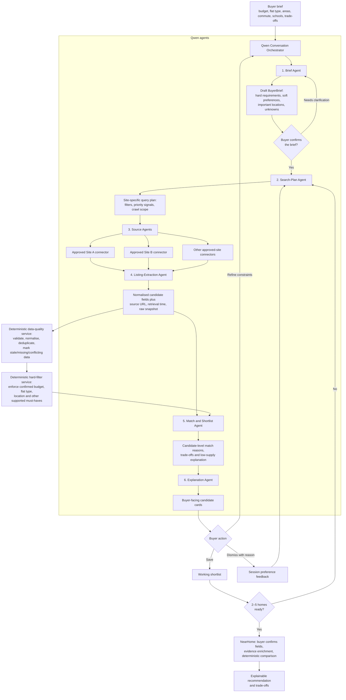

# NearHome Qwen Discovery Variant: Agent Workflow

> **Status:** Product-design proposal only. This describes a Qwen-enabled
> discovery flow; it is not part of the current deployed NearHome product.

## As-is versus to-be

## To-be: detailed multi-agent process

## What each Qwen agent does

| Qwen agent | Responsibility | Input | Output | Must not do |
| --- | --- | --- | --- | --- |
| Conversation Orchestrator | Own the conversation state and route work to the right specialist agent. | Buyer messages, confirmed brief, search status and feedback. | Next question, status update, or specialist-agent task. | Change confirmed requirements or present a listing as verified. |
| Brief Agent | Translate natural language into a buyer-readable structured brief; surface ambiguity. | Buyer needs and answers. | Draft `BuyerBrief`: hard requirements, preferences, locations, unknowns and assumptions. | Guess a budget, relaxation or requirement without buyer confirmation. |
| Search-Plan Agent | Turn the confirmed brief into a transparent, site-specific retrieval plan. | Confirmed `BuyerBrief`, site capabilities and session feedback. | Queries, crawl schedule, fields required and ranking signals. | Directly rank homes or circumvent a site's allowed access method. |
| Source Agent (one per approved site) | Retrieve currently available listings from its assigned property site. | Site query and connector configuration. | Raw listing snapshots, source URLs, retrieval times, status and errors. | Bypass logins, paywalls, robots rules, rate limits or terms of use. |
| Listing-Extraction Agent | Extract comparable listing fields and preserve evidence from each raw source result. | Raw listing snapshot and permitted metadata. | Candidate listing records with quoted evidence, missing fields and extraction confidence. | Invent missing fields or treat marketing claims as verified facts. |
| Match and Shortlist Agent | Produce a diverse set of eligible candidates and a clear low-supply explanation. | Hard-filtered listing records, confirmed preferences and feedback. | Candidate ordering, match reasons, trade-offs and optional relaxation suggestions. | Override a hard filter, secretly personalise by protected attributes, or pick the final home. |
| Explanation Agent | Write concise, evidence-linked candidate cards and answer buyer questions. | Candidate order, raw facts, source dates and limitations. | Plain-language reasons, cautions and comparison prompts. | Add unsupported claims, hide missing data or describe a ranking as certain. |

## Deterministic services that sit beside the Qwen agents

These are deliberately not delegated to Qwen:

- **Data-quality and deduplication service:** canonicalises address, price,
  floor area and flat type; detects the same unit across sites; records
  conflicts, source metadata and stale/unavailable status.
- **Hard-filter service:** enforces buyer-confirmed non-negotiables such as
  budget, flat type, required area and supported minimum size/lease rules.
- **NearHome comparison pipeline:** validates fields with buyer review,
  enriches saved listings with transaction, lease, transport, school and
  journey evidence, then performs deterministic requirement checks, scoring
  and recommendation explanation.

## Source-access rule

“All approved property websites” means every site for which NearHome has an
explicitly approved connector. A connector must use the site's permitted API,
partner feed or compliant crawler, respect rate limits and terms, and retain
source provenance. Failed or inaccessible sites must be reported to the buyer;
the agents must never imply exhaustive coverage when a connector did not run.

## Buyer-visible candidate card

Every shortlisted search result should display:

- asking price, flat type, floor area, address/town, source site and retrieval
  time;
- matched hard requirements and any missing, stale or unverified field;
- two or three brief-specific fit reasons and one material trade-off;
- a link to the source listing; and
- **Save**, **Dismiss**, **Compare later** and **Refine brief** actions.

Only when the buyer saves 2–5 homes does the flow enter existing NearHome.
NearHome then remains the trusted comparison layer, rather than letting a
language model make an opaque property-buying decision.
